# paper-figure-repro

可复用的**论文插图复现**工具包：一套脚本同时覆盖**统计图配方**与**真实地理数据地图**，
并强制记录“哪些是真实数据、哪些是模拟值”。

- 19 个统计图脚本：SHAP 蜂巢/玫瑰/同心环、GeoShapley 条形+饼图、分裂小提琴、
  Moran 散点、雨云图、极坐标年图、双轴时序、概念框架……
- 6 个真实地理数据地图：郑州 / 上海 / 哈尔滨研究区、中国 DEM、高程×坡度双变量、
  上海 PM2.5 暴露。
- 数据管线：DataV（GCJ→WGS84）、GADM、Esri 影像/浅灰底图、AWS DEM、
  ESA WorldCover、CHAP PM2.5、WorldPop、WorldClim、SoilGrids。
- 每个脚本输出 300 dpi PNG + 可编辑 PDF。

> 这不是“把图抄一遍”的仓库。统计图的数值默认是**模拟数据**（固定种子）；
> 地图的边界/DEM/影像/土地利用是**真实下载**的，主题栅格（PPFR、连通性、
> 县域碳排放等）在原文未公开处明确标为缺失。

## 快速开始

```bash
git clone https://github.com/KarlHeinrich-jpg/paper-figure-repro.git
cd paper-figure-repro
python -m pip install -r requirements.txt

python scripts/download_data.py        # ~450 MB，缓存到 geodata/
python scripts/run_all.py --charts     # 19 张统计图
python scripts/run_all.py --maps       # 6 张真实地图
```

单张：

```bash
python scripts/charts/art1_shap_beeswarm_rose.py
python scripts/maps/map_zhengzhou.py
```

自定义目录：

```bash
PFR_GEODATA=/data/geo PFR_OUT=/tmp/figs python scripts/maps/map_china_dem.py
```

## 示例

| 统计图 | 地图 |
|---|---|
| 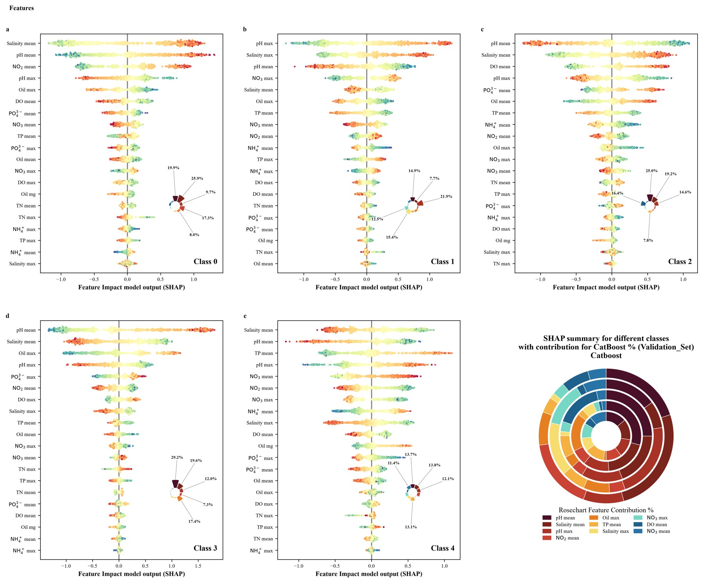 | 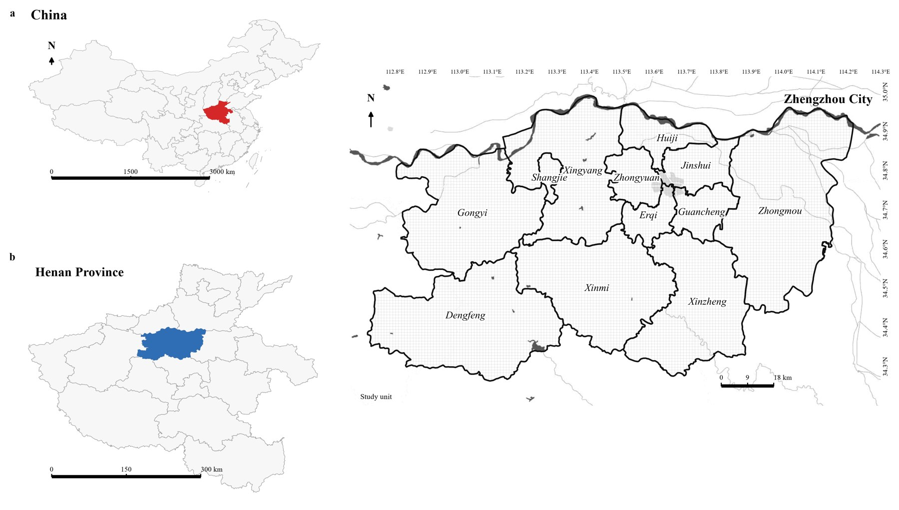 |
| 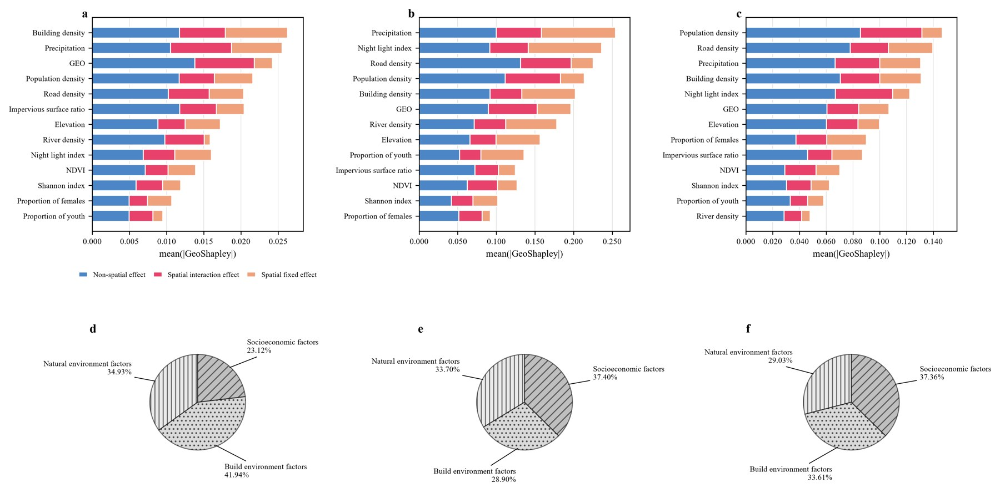 | 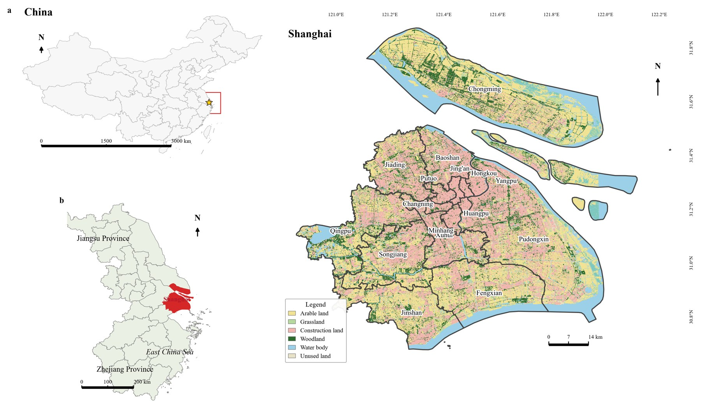 |
| 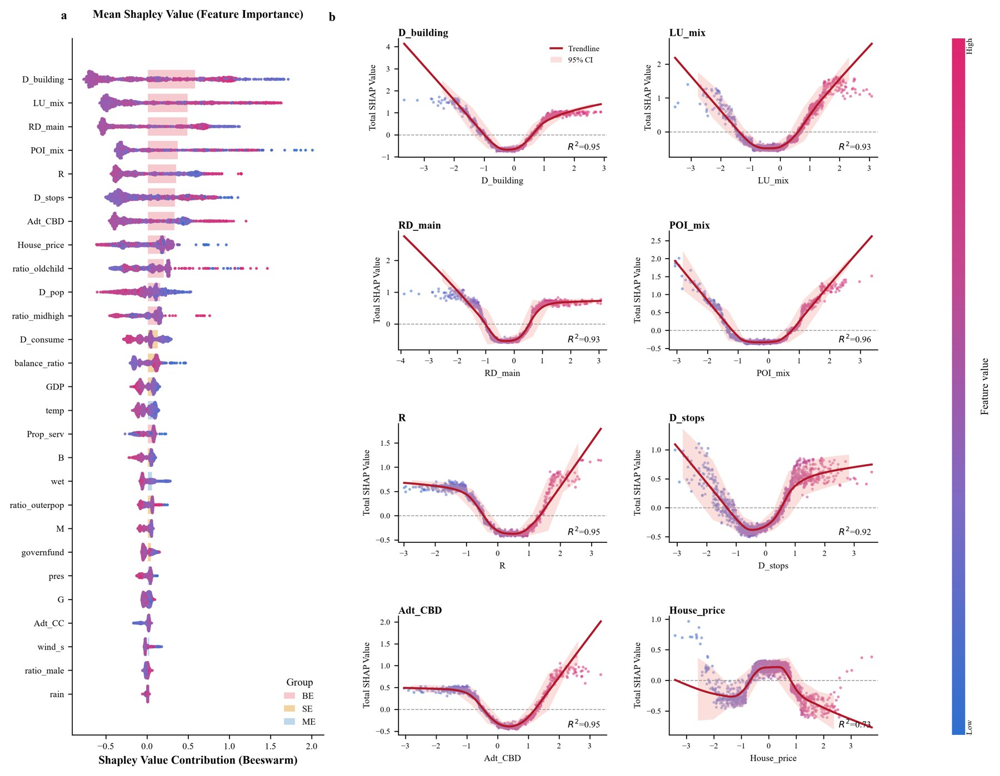 | 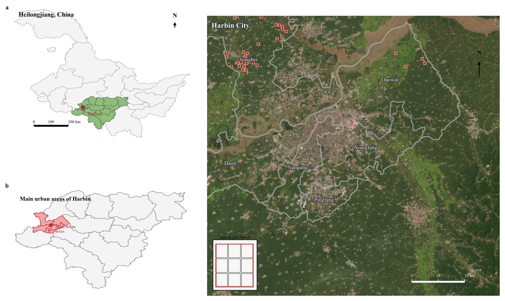 |
| 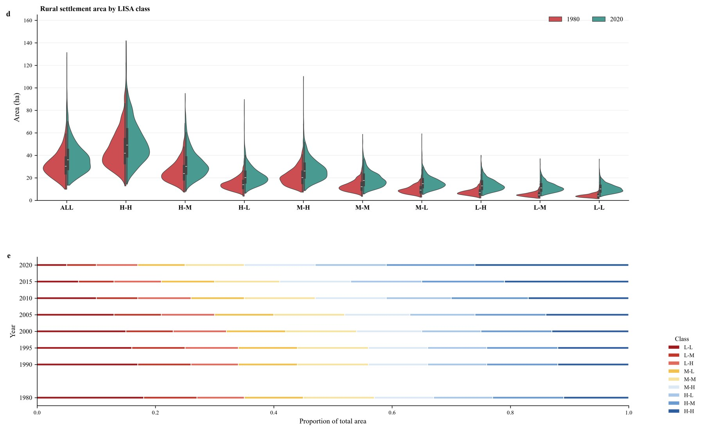 | 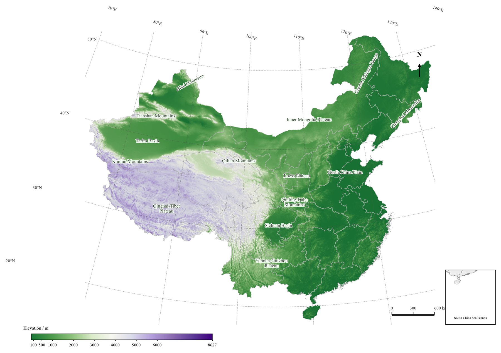 |
| 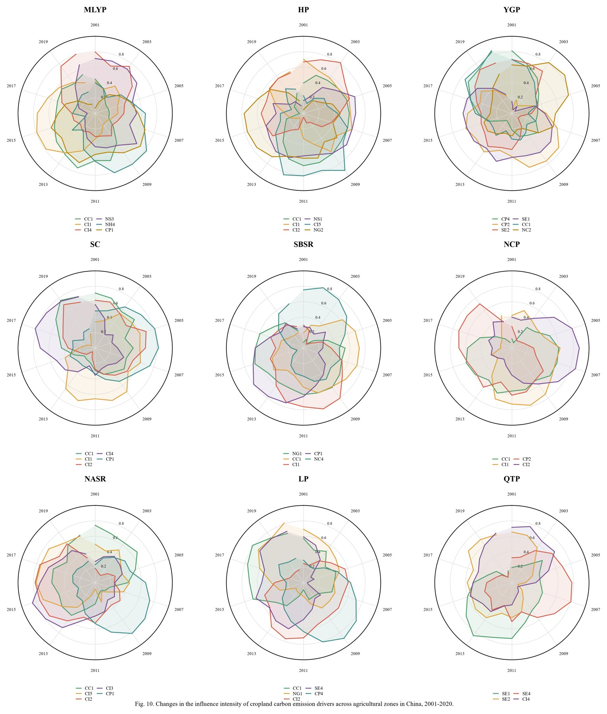 | 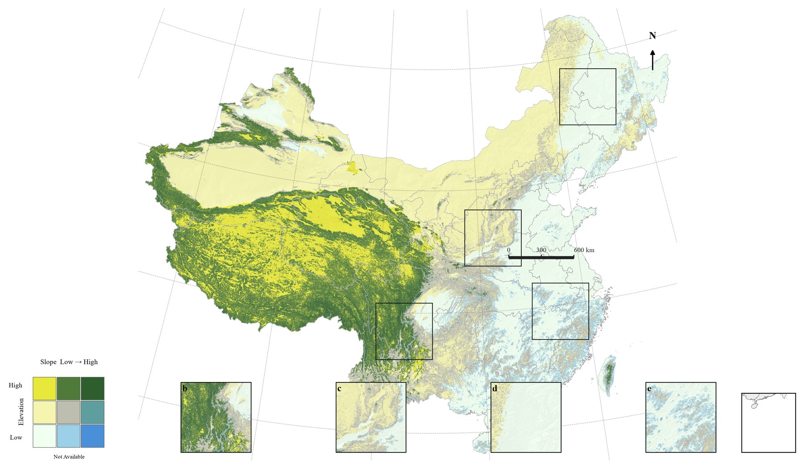 |
| 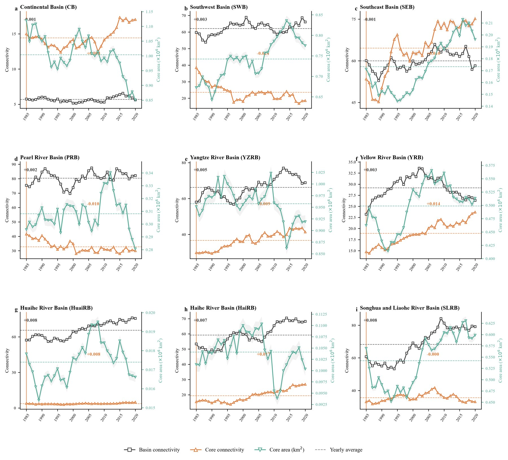 | 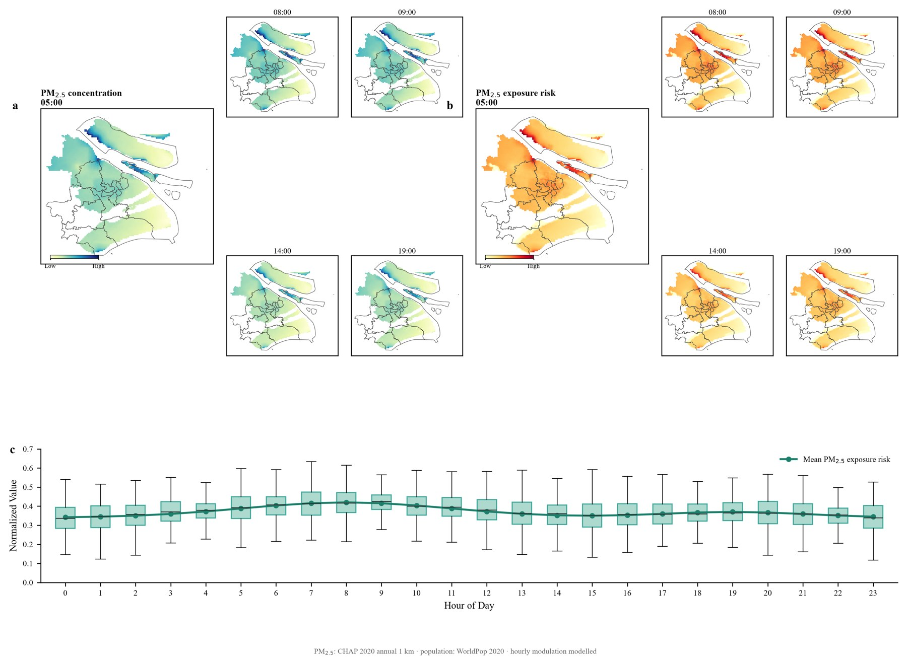 |

## 复现分级

| 级别 | 含义 |
|------|------|
| **A** | 图型可由公开库重建；脚本可直接跑 |
| **B** | 需要未公开的 shp/栅格/问卷记录；只交真实底图模板 |
| **C** | 手绘插画/照片/UI；不绘制，写清原因 |

完整判定见 [`docs/figure_inventory.csv`](docs/figure_inventory.csv)，真实案例见
[`docs/CASE_STUDY.md`](docs/CASE_STUDY.md)，工作流见 [`SKILL.md`](SKILL.md)。

## 数据与许可

- 代码：MIT（见 `LICENSE`）。
- 本仓库的渲染结果与文档：CC BY 4.0。
- 第三方数据：DataV、GADM、Esri、AWS/Mapzen、ESA WorldCover、CHAP、WorldPop、
  WorldClim、SoilGrids。各自的许可/引用要求见
  [`docs/DATA_SOURCES.md`](docs/DATA_SOURCES.md)。
- **不包含**原论文/公众号图片、`geodata/` 缓存和 `outputs/` 结果。

## 作为 skill 使用

把整个目录放到 skill 搜索路径（例如 `~/.agents/skills/paper-figure-repro/`），
或直接把 `SKILL.md` 交给支持 Agent Skills 的客户端。触发词与工作流写在
`SKILL.md` 的 frontmatter 和正文里。

## 已知限制

- 统计图的数值是模拟的；换成自己的数据只需替换脚本顶部的数据生成块。
- 主题栅格（PPFR、连通性、县域碳排放、土地覆盖变化）原文未公开，无法数值复刻。
- 地图标注位置、色带停靠点是按原图目测重建，不保证逐像素一致。
- 使用 Esri 底图时请遵守 Esri 的使用条款，不要把瓦片缓存再分发。

## 引用

如果这个仓库帮到了你，可以按下面引用：

```
Wang, Y. (2026). paper-figure-repro: reusable Python recipes for reproducing
journal figures with real geodata. GitHub.
https://github.com/KarlHeinrich-jpg/paper-figure-repro
```
